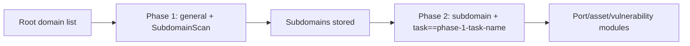

---

## name: scopesentry-mcp
description: Manage the ScopeSentry security scanning platform (projects, tasks, templates, assets, nodes) via the ScopeSentry MCP. Use when the user mentions ScopeSentry, MCP, API keys, scan tasks, or asset queries.

# ScopeSentry MCP Usage Guide

For users with a **deployed ScopeSentry instance**. Connect to the platform through Cursor (or another MCP client) — no local source code required.

## 1. Prerequisites

### 1.1 Verify Service Accessibility

- Default web UI: `http://<host>`
- MCP endpoint: `http://<host>/mcp` (if a reverse proxy or frontend proxy sits in front, use the actual `/mcp` address)

### 1.2 Create an API Key

1. Log in to the ScopeSentry web UI in a browser
2. Go to the **API Key** management page and create a key (or create one via the admin-provided endpoint)
3. Save the returned `ssk_...` string (**shown only once**)

### 1.3 Configure Cursor MCP

Cursor → Settings → MCP → Add server:

```json
{
  "mcpServers": {
    "scopesentry": {
      "url": "http://<your-host>:8082/mcp",
      "headers": {
        "X-API-Key": "ssk_<your-key>"
      }
    }
  }
}
```

Alternatively, use: `Authorization: Bearer ssk_<your-key>`

After configuring, restart MCP or reload Cursor and confirm that tools such as `list_projects` and `list_assets` appear in the tool list.

---

## 2. Tool Overview


| Tool                   | Purpose                                            |
| ---------------------- | -------------------------------------------------- |
| `list_projects`        | Project tree grouped by tag (includes project IDs) |
| `list_projects_data`   | Paginated project list, searchable by name         |
| `get_project`          | Project details                                    |
| `create_project`       | Create a project                                   |
| `list_tasks`           | Scan task list                                     |
| `get_task`             | Task details                                       |
| `list_scan_templates`  | Scan template list                                 |
| `get_scan_template`    | Template details                                   |
| `list_plugin_modules`  | Scan pipeline module names                         |
| `list_plugins`         | Available plugins (with hash, default parameters)  |
| `create_scan_template` | Create a scan template                             |
| `create_scan_task`     | Create a scan task                                 |
| `list_assets`          | Query assets of any type (paginated list)          |
| `count_assets`         | Count assets (`/api/assets/common/total`)          |
| `get_asset_detail`     | Asset or vulnerability details                     |
| `add_asset_tag`        | Add a tag to an asset                              |
| `list_nodes`           | Scan node list                                     |


Tool parameters follow each tool's MCP description (schema); `list_assets` / `count_assets` share the same `search` and `filter` syntax — read the `list_assets` description before querying assets.

When you need to know "how many in total", use `count_assets` (it maps to the web pagination total endpoint) instead of paging through `list_assets` repeatedly just to count.

---

## 3. Common Workflows

### 3.1 Query Assets by Project

When the user or context **already specifies a project**, pass `filter.project` first to narrow the scope; too much cross-project data slows responses. If no project is specified, adding a project filter is optional.

1. `list_projects` or `list_projects_data` to get the target project's **ObjectID** (`id` / `children[].value`)
2. `list_assets` with `filter.project` (**must be the ID, not the project's display name**)

```json
{
  "asset_type": "asset",
  "pageIndex": 1,
  "pageSize": 20,
  "search": "domain=^example.com",
  "filter": {
    "project": ["<project-ObjectID>"]
  }
}
```

### 3.2 Create a Scan Task

1. `list_nodes` to get online node names
2. `list_scan_templates` or `create_scan_template` to get the template **ObjectID**
3. `create_scan_task`: `name` and `node` are required; `template` takes the template ID (not the template name)

**Target source `targetSource` (same as the web UI):**

| targetSource | Description | Required parameters |
| --- | --- | --- |
| `general` | Enter targets directly | `target` |
| `project` | Read targets from a project | `project` (array of project ObjectIDs) |
| `asset` | Search the web asset inventory | `search`; optional `project`, `filter`, `targetNumber` |
| `RootDomain` | Search the root-domain inventory | `search`; optional `project`, `filter`, `targetNumber` |
| `subdomain` | Search the subdomain inventory | `search`; optional `project`, `filter`, `targetNumber` |
| `UrlScan` | Search URL scan results | `search`; optional `project`, `filter`, `targetNumber` |
| `*Source` (e.g. `subdomainSource`) | Create from "selected/searched" rows on an asset page | `search` when `targetTp=search`; `targetIds` when `targetTp=select` |

**Example — scan root domains directly:**

```json
{
  "name": "example-subdomain-enumeration",
  "node": ["node-1"],
  "template": "<template-ObjectID>",
  "targetSource": "general",
  "target": "example.com\nfoo.com",
  "project": ["<project-ObjectID>"]
}
```

**Example — continue from the subdomain inventory (filtered by the previous task name):**

```json
{
  "name": "example-ports-and-vulns",
  "node": ["node-1"],
  "template": "<follow-up-modules-template-ObjectID>",
  "targetSource": "subdomain",
  "search": "task==\"example-subdomain-enumeration\"",
  "project": ["<project-ObjectID>"]
}
```

### 3.3 Full Reconnaissance on Root Domains (Two-Phase Recommended)

When the input is **root domains** and the goal is **full reconnaissance**, run two scans instead of one full pipeline.

**Why:** distributed tasks are dispatched **per target**. When a root domain is the target, once a node receives it, the subdomains found on that node also run their later modules on the same node — easily causing unbalanced load, slowness, and errors.

**Best practices:**

1. **Phase 1 — subdomain enumeration only**
   - `targetSource`: `general`
   - `target`: all root domains (one per line)
   - Template: enable only `SubdomainScan` and `SubdomainSecurity` (subdomain scanning + subdomain takeover)
   - Use `get_task` to wait for completion

2. **Phase 2 — subsequent modules**
   - `targetSource`: `subdomain`
   - `search`: `task=="<phase-1-task-name>"` (exact match on the task name)
   - Optional `project` to narrow the scope
   - Template: port scanning, asset mapping, vulnerability scanning, etc. (`SubdomainScan` not required)
   - Subdomains are dispatched to all nodes as independent targets — much better parallelism

Alternatively, filter the "Subdomain" asset page by task name in the web UI and use "Create task from subdomains" — same effect.



### 3.4 Create a Scan Template

1. `list_plugin_modules` → module name list
2. `list_plugins` (filterable by `module`) → each plugin's `hash` and default `parameter`
3. `create_scan_template`: use `modules` to map "module → array of plugin hashes"

---

## 4. Asset Queries (`list_assets` / `count_assets`)

`count_assets` shares `asset_type`, `search`, and `filter` with `list_assets` and returns `{ "total": N }`, matching the web endpoint `/api/assets/common/total`.

```json
{
  "asset_type": "subdomain",
  "search": "task==\"some-task-name\"",
  "filter": {"project": ["<project-ObjectID>"]}
}
```

**Performance tips (apply to both `list_assets` / `count_assets`):** when a project is known, use `filter.project` to narrow the scope; in `search`, prefer `==` exact match or `^` prefix match on indexed fields (see [4.3](#43-search-expressions)) and avoid broad `=` fuzzy queries that slow responses. Without project context, adding a project filter is optional.

For which types support `filter.project`, see the table in [4.4](#44-exact-filter).

### 4.1 Asset Types `asset_type`

`asset`, `RootDomain`, `subdomain`, `app`, `mp`, `UrlScan`, `SensitiveResult`, `DirScanResult`, `crawler`, `vulnerability`, `PageMonitoring`, `IPAsset`, `SubdomainTakerResult`

Alias examples: `web`→asset, `vuln`→vulnerability, `ip`→IPAsset, `url`→UrlScan

### 4.2 Parameters


| Parameter                | Description                                             |
| ------------------------ | ------------------------------------------------------- |
| `pageIndex` / `pageSize` | Pagination, defaults 1 / 20                             |
| `search`                 | Search expression (see next section)                    |
| `filter`                 | Exact-match filter JSON (see next section)              |
| `sort`                   | Only UrlScan and DirScanResult support `length` sorting |
| `sid`                    | SensitiveResult only: sensitive-data rule name          |


`search` and `filter` **can be combined**.

### 4.3 `search` Expressions

Custom DSL (**not SQL**):


| Operator | Meaning                   | Index       | Example                            |
| -------- | ------------------------- | ----------- | ---------------------------------- |
| `=`      | Fuzzy match (regex)       | Not indexed | `domain=example`                   |
| `==`     | Exact match (equality)    | **Indexed** | `port==443`                        |
| `!=`     | Exclusion                 | —           | `port!="80"`                       |
| `&&`     | AND                       | —           | `domain==example.com && port==443` |
| `\|\|`   | OR                        | —           | `title=admin \|\| body=login`      |


**Indexes and operators:** fields such as `domain`, `ip`, `port`, `title` are indexed, but only **`==` equality** or **prefix match with a leading `^` in the value** (e.g. `domain=^example.com`) uses the index; **`=` becomes a regex fuzzy match and cannot use the index**, which slows down on large datasets.

**`search` fields common to all types:** `tag`, `task` (task name), `rootDomain`

**`project` cannot appear in `search`** (it is invalid, or errors when combined with `&&`). To filter by project, use `filter.project`.

**Common `search` fields per type:**


| asset_type           | Fields                                                                              |
| -------------------- | ----------------------------------------------------------------------------------- |
| asset                | domain, ip, port, service, app, title, statuscode, icon, banner, type, body, header |
| RootDomain           | domain, icp, company                                                                |
| subdomain            | domain, ip, type, value                                                             |
| app                  | name, icp, company, category, description, url, apk                                 |
| mp                   | name, icp, company, category, description, url                                      |
| UrlScan              | url, input, source, resultId, type                                                  |
| SensitiveResult      | url, sname, body, info, md5                                                         |
| DirScanResult        | url, statuscode, redirect, length                                                   |
| vulnerability        | url, vulname, matched, request, response, level                                     |
| crawler              | url, method, body, resultId                                                         |
| PageMonitoring       | url, hash, diff, response                                                           |
| IPAsset              | ip, domain, port, service, webServer, app                                           |
| SubdomainTakerResult | domain, value, type, response                                                       |


**`search` examples:**

- `domain==www.example.com && port==443` (equality, indexed)
- `domain=^example.com` (prefix match, indexed)
- `ip==192.168.1.1`
- `task=="some-task-name"`
- `level==high` (vulnerability)
- `statuscode==200` (DirScanResult)

Use `=` only when fuzzy containment is needed, e.g. `title=admin` (not indexed; pair it with filters such as project to narrow the scope).

### 4.4 `filter` Exact Matching

JSON object: multiple values under the same key are **OR**ed; different keys are **AND**ed.

**Prefer `project` when a project is known:** if the user or context already names a project and the asset_type supports `project`, include it to narrow the scope; otherwise it is optional.


| filter key   | Meaning             | Values                                                            |
| ------------ | ------------------- | ----------------------------------------------------------------- |
| `project`    | Owning project      | **ObjectID**, obtained via `list_projects` / `list_projects_data` |
| `task`       | Source task         | **Task name**, the `name` from `list_tasks`                       |
| `port`       | Port                | e.g. `"443"`                                                      |
| `service`    | Service/protocol    | e.g. `"https"`                                                    |
| `app`        | App fingerprint     | e.g. `"Nginx"`                                                    |
| `icon`       | Icon hash           |                                                                   |
| `statuscode` | HTTP status code    | Mainly for asset                                                  |
| `status`     | Status              | UrlScan/DirScan HTTP code; vulnerability/sensitive-data status    |
| `level`      | Vulnerability level | critical / high / medium / low / info                             |
| `type`       | Type                | e.g. subdomain record type A, CNAME                               |
| `color`      | Sensitive-rule color | SensitiveResult                                                  |
| `sname`      | Sensitive-rule name | SensitiveResult                                                   |
| `tags`       | Tags                |                                                                   |


**Available filter keys per type:**


| asset_type                            | Filter keys                                                     |
| ------------------------------------- | --------------------------------------------------------------- |
| asset                                 | project, port, service, app, icon, statuscode, type, task, tags |
| RootDomain                            | project, tags                                                   |
| subdomain                             | project, type, task, tags                                       |
| app / mp                              | project, tags                                                   |
| UrlScan                               | status, tags                                                    |
| DirScanResult                         | status, tags                                                    |
| SensitiveResult                       | status, color, sname, tags                                      |
| crawler                               | project, task, tags                                             |
| vulnerability                         | project, level, status, task, tags                              |
| PageMonitoring / SubdomainTakerResult | tags                                                            |
| IPAsset                               | project, port, service, app                                     |


**`filter` example:**

```json
{"project": ["<project-ObjectID>"], "port": ["443"]}
```

**Combined query example:**

```json
{
  "asset_type": "asset",
  "search": "domain=^baidu && port==443",
  "filter": {"project": ["<project-ObjectID>"]},
  "pageIndex": 1,
  "pageSize": 10
}
```

**Notes:**

- When a project is known, prefer `filter.project` (where supported); without project context it is optional
- Do not put the project's display name in `filter.project`
- Use `==` for known values and `^` for prefixes; avoid `=` fuzzy matching on large collections
- For UrlScan HTTP status use `filter.status`; for DirScanResult use `statuscode==200` in `search`
- For SensitiveResult by rule name: `search` with `sname=<rule-name>`, or `filter.sname`

### 4.5 Sorting `sort`

Only **UrlScan** and **DirScanResult** support it:

```json
{"length": "ascending"}
```

Other types ignore `sort` and sort by time by default.

---

## 5. Scan Template Module Names

`TargetHandler`, `SubdomainScan`, `SubdomainSecurity`, `PortScanPreparation`, `PortScan`, `PortFingerprint`, `AssetMapping`, `AssetHandle`, `URLScan`, `WebCrawler`, `URLSecurity`, `DirScan`, `VulnerabilityScan`, `PassiveScan`

---

## 6. Troubleshooting


| Symptom                 | Fix                                                                                |
| ----------------------- | ---------------------------------------------------------------------------------- |
| No MCP tools            | Check the URL, API key, and that ScopeSentry is running                            |
| 401 / 403               | Recreate or replace the API key                                                    |
| Assets not found        | Ensure `filter.project` is an ObjectID; do not put project in `search`             |
| Template/task creation fails | `template` must be a template ObjectID; `node` takes online node names         |
| Slow/stuck queries      | Add `filter.project` when a project is known; in `search` use `==` or `^` prefix on indexed fields and avoid `=`; reduce `pageSize` |


---
